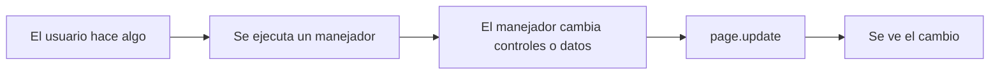

# Vocabulario y esquema

| Concepto | Qué es |
|---|---|
| **Page** | La ventana de la app. Recibe los controles y tiene propiedades como `title` o `padding`. |
| **Control** | Cualquier elemento visual: `Text`, `TextField`, `Button`, `Checkbox`, `Row`… |
| **Layout** | Control que contiene a otros y decide cómo colocarlos: `Row` (horizontal), `Column` (vertical). |
| **Propiedad** | Característica de un control que se lee o cambia: `value`, `label`, `size`, `expand`… |
| **Evento** | Algo que ocurre en la interfaz: clic, escribir, marcar una casilla, pulsar Enter. |
| **Manejador** | Función que se ejecuta cuando ocurre un evento. Recibe un parámetro `e`. |
| **`page.update()`** | Envía los cambios a la pantalla. Si modificas algo y no lo llamas, **no se ve**. |

## El esquema que repiten todas las apps

```python
import flet as ft

def main(page: ft.Page):
    page.add(...)        # aquí construimos la interfaz

ft.run(main)             # arranca la app
```

## El flujo de toda app Flet



!!! note "Idea clave"
    Cambiar una variable de Python **no** cambia la pantalla. La pantalla solo se entera cuando llamas a `page.update()` (o `self.update()` en una clase).
