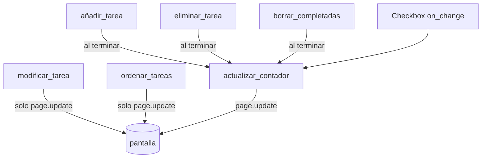

# Función por función

Cada página explica **una** función de la app final: qué hace, qué recibe, quién la llama, qué toca y **por qué está en ese sitio**.

| Función | Evento que la dispara | Cambia | Llama a |
|---|---|---|---|
| [`main`](main.md) | arranque de la app | construye todo | — |
| [`actualizar_contador`](actualizar_contador.md) | marcar casilla / lo llaman las demás | texto y color del contador | `page.update()` |
| [`eliminar_tarea`](eliminar_tarea.md) | clic en la papelera | quita una fila | `actualizar_contador` |
| [`añadir_tarea`](anadir_tarea.md) | clic en Añadir / Enter | añade una fila | `actualizar_contador` |
| [`borrar_completadas`](borrar_completadas.md) | clic en el botón | quita varias filas | `actualizar_contador` |
| [`modificar_tarea`](modificar_tarea.md) | clic en el lápiz | cambia el `label` | `page.update()` |
| [`ordenar_tareas`](ordenar_tareas.md) (nueva) | clic en un botón de ordenar | reordena `tareas.controls` | `page.update()` |
| [`Tarea` / `AppTareas`](clases.md) | — | versión con clases | — |

!!! note "Regla"
    Las funciones que **cambian el número de pendientes** acaban llamando a `actualizar_contador()`. Las que no lo cambian (modificar, ordenar) solo llaman a `page.update()`.
