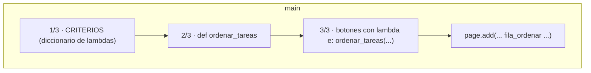

# Dónde va cada trozo en el código

En `codigo/ordenar_funcional.py` (la app final de la práctica) hay **3 sitios**, marcados con `# >>> ORDENAR`.



## 1/3 y 2/3 · Criterios y función

**Dentro de `main`, después de `modificar_tarea` y antes de `añadir_tarea`.**

```python linenums="81" title="Líneas 81-101"
--8<-- "codigo/ordenar_funcional.py:81:101"
```

| Código | Qué hace |
|---|---|
| `CRITERIOS = {` | Diccionario con los criterios: nombre → función key. |
| `"az": lambda fila: fila.controls[0].label.lower()` | A-Z por el texto del Checkbox, sin distinguir mayúsculas. |
| `"estado": lambda fila: fila.controls[0].value` | Por estado: `False` (pendiente) antes que `True`. |
| `"longitud": lambda fila: len(fila.controls[0].label)` | Por número de letras. |
| `"estado_az": lambda fila: (..., ...)` | Tupla: primero estado y, dentro, A-Z. |
| `def ordenar_tareas(criterio, inverso=False):` | Función que ordena; `inverso` vale `False` si no se indica. |
| `tareas.controls.sort(key=CRITERIOS[criterio], reverse=inverso)` | Ordena la lista de filas con el criterio elegido. |
| `page.update()` | Redibuja con el nuevo orden. |

!!! note "Por qué aquí"
    - Tiene que estar **dentro de `main`** para ver `tareas` y `page`.
    - Va **después de `tareas = ft.Column()`**, porque la usa.
    - No necesita estar antes que `añadir_tarea` (solo se ejecuta cuando se pulsa un botón), pero juntarla con las demás funciones mantiene el código ordenado.
    - Las lambdas del diccionario **no se ejecutan** al crearlo; solo cuando `sort` las llama.

## 3/3 · Los botones

**Después de definir `ordenar_tareas`, junto a los demás botones** (`boton`, `boton_borrar`).

```python linenums="172" title="Líneas 172-184"
--8<-- "codigo/ordenar_funcional.py:172:184"
```

| Código | Qué hace |
|---|---|
| `fila_ordenar = ft.Row(...)` | Fila horizontal con los botones de ordenar. |
| `wrap=True` | Si no caben, saltan a la línea de abajo. |
| `ft.Text("Ordenar:")` | Etiqueta delante de los botones. |
| `on_click=lambda e: ordenar_tareas("az")` | A-Z. La lambda recibe `e` y pasa el criterio. |
| `ordenar_tareas("az", inverso=True)` | Z-A: mismo criterio, invertido. |
| `ordenar_tareas("estado")` | Pendientes primero. |
| `ordenar_tareas("longitud")` | Cortas primero. |
| `ordenar_tareas("estado_az")` | Pendientes primero y A-Z. |

!!! note "Por qué lambda aquí"
    `on_click` solo entrega `e`, pero `ordenar_tareas` necesita el criterio. `lambda e: ordenar_tareas("az")` hace de intermediaria ([lambda explicada](../controles/lambda.md)).

!!! tip "`wrap=True`"
    Con 5 botones en una `Row`, `wrap=True` hace que salten de línea si no caben.

## Añadirlos a la página

En el `page.add(...)` del final, en la posición donde quieras verlos (aquí entre el contador y la lista):

```python
page.add(titulo, ft.Row([nueva_tarea, boton]), mensaje, contador, fila_ordenar, tareas, boton_borrar)
#                                                                  ^^^^^^^^^^^^ nuevo
```

| Código | Qué hace |
|---|---|
| `fila_ordenar` | La fila de botones, colocada entre el contador y la lista. |

## Resumen de 30 segundos

1. Pega `CRITERIOS` y `ordenar_tareas` **dentro de `main`**, tras `modificar_tarea`.
2. Crea `fila_ordenar` con los botones, junto a los otros botones.
3. Añade `fila_ordenar` a `page.add(...)`.
4. Prueba: añade «pera», «Manzana», «kiwi» y pulsa **A-Z**.

## ¿Y si quiero ordenar automáticamente al añadir?

Llama a `ordenar_tareas("az")` al final de `añadir_tarea`, **antes** de `actualizar_contador()` (que hace el `page.update()`):

```python
    tareas.controls.append(fila)
    nueva_tarea.value = ""
    tareas.controls.sort(key=CRITERIOS["az"])   # mantiene la lista siempre ordenada
    actualizar_contador()
```

| Código | Qué hace |
|---|---|
| `tareas.controls.append(fila)` | Añade la tarea nueva al final. |
| `nueva_tarea.value = ""` | Vacía el campo. |
| `tareas.controls.sort(key=CRITERIOS["az"])` | Reordena A-Z justo después de añadir: la lista siempre queda ordenada. |
| `actualizar_contador()` | Recalcula y hace el `page.update()` que muestra el orden. |

(No uses `ordenar_tareas(...)` aquí si no quieres un `page.update()` extra: `actualizar_contador` ya lo hace.)

## Cosas que se rompen si cambias la fila

Las lambdas usan `fila.controls[0]`. Si metes otro control **antes** del Checkbox, o cambias la estructura de la fila, hay que actualizar el índice en `CRITERIOS`, `actualizar_contador`, `borrar_completadas` y `modificar_tarea`. Con la [versión con clases](clases.md) este problema desaparece.
