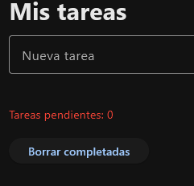

# Botón «Borrar completadas»

**Objetivo:** eliminar todas las filas con el checkbox marcado y actualizar el contador.

## 1. La función (junto a `eliminar_tarea`, dentro de `main`)

```python
def borrar_completadas(e):
    for fila in list(tareas.controls):      # recorremos una COPIA de la lista
        if fila.controls[0].value:          # checkbox marcado = completada
            tareas.controls.remove(fila)
    actualizar_contador()                   # recalcula (y hace page.update())
```

| Código | Qué hace |
|---|---|
| `def borrar_completadas(e):` | Manejador del botón: recibe el evento `e` (no se usa). |
| `for fila in list(tareas.controls):` | Recorre una **copia** de la lista de filas, para poder borrar de la original sin saltarse ninguna. |
| `if fila.controls[0].value:` | Si el Checkbox de la fila está marcado (`True`)… |
| `tareas.controls.remove(fila)` | …quita esa fila de la lista. |
| `actualizar_contador()` | Recalcula el contador y redibuja (esa función hace `page.update()`). |

## 2. El botón (después de definir la función) y a la página

```python
boton_borrar = ft.Button(content="Borrar completadas", on_click=borrar_completadas)

page.add(titulo, ft.Row([nueva_tarea, boton]), mensaje, contador, tareas, boton_borrar)
```

| Código | Qué hace |
|---|---|
| `ft.Button(content="Borrar completadas", ...)` | Crea el botón con ese texto. |
| `on_click=borrar_completadas` | Al pulsarlo se ejecuta la función (sin paréntesis). |
| `page.add(..., boton_borrar)` | Añade el botón al final de la página, debajo de la lista. |

!!! danger "Por qué `list(tareas.controls)`"
    **Nunca borres elementos de una lista mientras la recorres**: Python se salta elementos. Con `list(...)` se recorre una *copia* y se borra de la original.

!!! tip "Sin lambda"
    `on_click=borrar_completadas` sin paréntesis ni lambda: la función ya está definida y solo necesita `e`.

{ width=300 }
