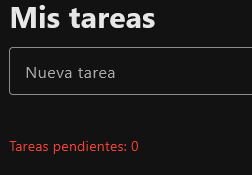
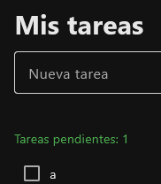
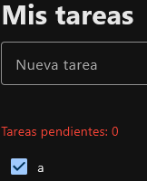

# Color del contador (rojo / verde)

**Objetivo:** rojo si no hay tareas pendientes, verde si hay alguna.

## 1. Color inicial (al crear el contador)

Empezamos sin tareas, así que arranca en rojo:

```python
contador = ft.Text("Tareas pendientes: 0", color=ft.Colors.RED)
```

## 2. Cambio de color (dentro de `actualizar_contador`, tras calcular `pendientes`)

```python
if pendientes == 0:
    contador.color = ft.Colors.RED
else:
    contador.color = ft.Colors.GREEN
```

!!! note "Por qué en `actualizar_contador`"
    Es la función que **todos los eventos** (añadir, borrar, marcar) ya llaman. Poniendo ahí el color, siempre está sincronizado con el número. Es el mismo principio del [estado derivado](../pasos/paso8.md).

| Sin tareas | 1 pendiente | Todo marcado |
|---|---|---|
| { width=200 } | { width=200 } | { width=200 } |
