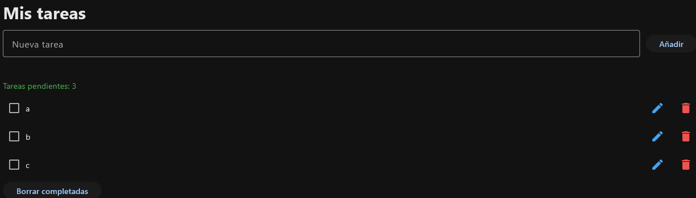

# Botón «Modificar»

**Objetivo:** cambiar el texto de una tarea existente. El texto nuevo se escribe en el campo «Nueva tarea» y se pulsa el lápiz de esa tarea.

## 1. La función (dentro de `main`, antes de `añadir_tarea`)

```python
def modificar_tarea(fila):
    texto = nueva_tarea.value.strip()        # texto nuevo del campo
    if not texto:                            # vacío: avisa y no modifica
        nueva_tarea.error = "Escribe el texto nuevo"
        page.update()
        return
    fila.controls[0].label = texto           # cambia el texto del checkbox de ESA fila
    nueva_tarea.error = None
    nueva_tarea.value = ""
    page.update()
```

| Código | Qué hace |
|---|---|
| `def modificar_tarea(fila):` | Recibe la fila cuyo lápiz se ha pulsado. |
| `texto = nueva_tarea.value.strip()` | Lee el texto nuevo del campo «Nueva tarea», sin espacios. |
| `if not texto:` | Si está vacío… |
| `nueva_tarea.error = "Escribe el texto nuevo"` | …muestra un error bajo el campo, |
| `page.update() / return` | …lo dibuja y sale sin cambiar nada. |
| `fila.controls[0].label = texto` | Cambia el texto del Checkbox (`controls[0]`) de **esa** fila. |
| `nueva_tarea.error = None` | Quita el error si lo había. |
| `nueva_tarea.value = ""` | Vacía el campo. |
| `page.update()` | Redibuja para que se vea el texto nuevo. |

## 2. El botón en cada fila (dentro de `añadir_tarea`, en `fila.controls`, **entre el Checkbox y el de eliminar**)

```python
ft.IconButton(
    icon=ft.Icons.EDIT,
    icon_color=ft.Colors.BLUE_400,
    on_click=lambda e: modificar_tarea(fila),   # lambda para pasar la fila
),
```

| Código | Qué hace |
|---|---|
| `ft.IconButton(...)` | Botón con icono en vez de texto. |
| `icon=ft.Icons.EDIT` | Icono de lápiz. |
| `icon_color=ft.Colors.BLUE_400` | Lápiz en azul. |
| `on_click=lambda e: modificar_tarea(fila)` | Al pulsar, llama a `modificar_tarea` con **su** fila (la lambda la captura). |

!!! note "Por qué se puede modificar así"
    `fila.controls[0]` es el `Checkbox`; cambiar su `label` cambia el texto. Como el botón está **dentro** de cada fila y la lambda captura `fila`, cada lápiz modifica **su** tarea (igual que cada papelera borra la suya).

!!! warning "Limitación"
    `modificar_tarea` no comprueba si el texto nuevo ya existe (como sí hace `añadir_tarea`). Es una buena mejora para hacer.

{ width=600 }
