# Publicar la app: web, APK, Windows y Linux

Todos los formatos se generan con `flet build <plataforma>`. Se ejecuta desde la carpeta del proyecto y con el entorno virtual activado.

```bash
flet build web     --module-name paso8_app_final
flet build apk     --module-name paso8_app_final
flet build windows --module-name paso8_app_final
flet build linux   --module-name paso8_app_final
```

`--module-name` es el nombre del archivo `.py` **sin** la extensión. El resultado aparece en la carpeta `build/<plataforma>/`.

=== "Web"

    ```bash
    flet build web --module-name paso8_app_final
    ```

    Se comprueba sirviendo `build/web` en local y abriendo `http://localhost:8000`.

    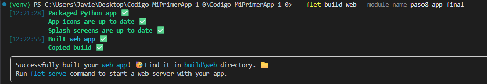
    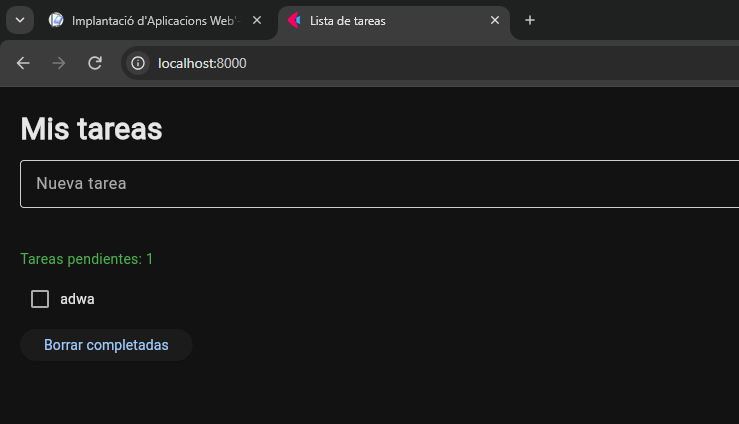{ width=600 }

=== "Android (APK)"

    ```bash
    flet build apk --module-name paso8_app_final
    ```

    Si no hay Android SDK, Flet pregunta si lo instala (`y`). Resultado: `build/apk/*.apk`, que se instala en el móvil.

    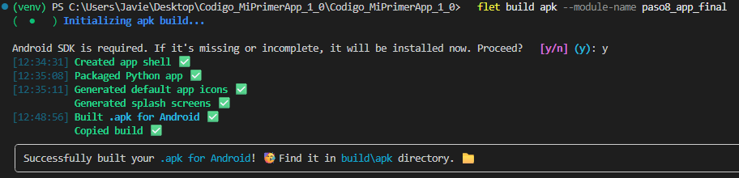
    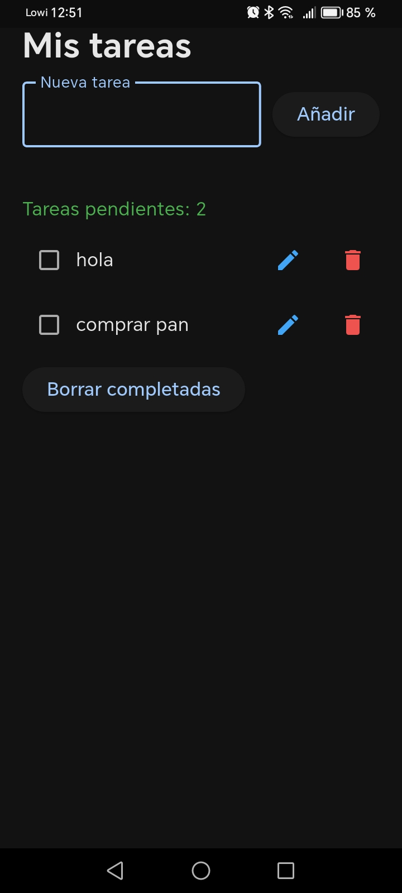{ width=240 }

=== "Windows"

    Requisitos: **Visual Studio Community** (carga de trabajo «Desarrollo para el escritorio con C++») y activar el **Modo desarrollador** de Windows.

    ```powershell
    flet build windows --module-name paso8_app_final
    ```

    Resultado en `build/windows/`: el `.exe` junto a sus DLL (hay que mantenerlos juntos).

    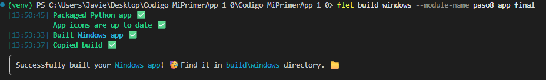
    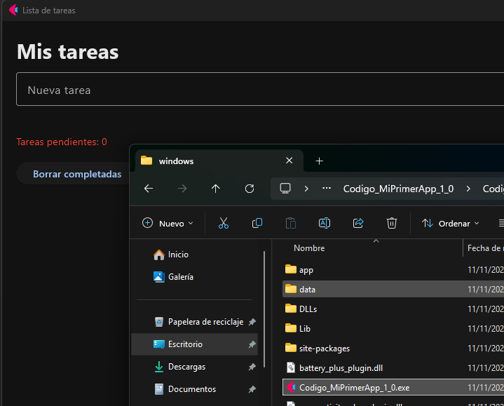{ width=600 }

=== "Linux (con Docker desde Windows)"

    Como en Windows no se puede compilar para Linux directamente, se usa un contenedor Ubuntu.

    **1. Abrir el contenedor** montando la carpeta del proyecto en `/app`:

    ```powershell
    docker run -it --rm -v "${PWD}:/app" ubuntu:24.04 bash
    ```

    **2. Instalar Python y Flet** (dentro del contenedor):

    ```bash
    apt update && apt install -y python3 python3-pip python3-venv curl git unzip xz-utils jq
    python3 -m venv /venv && source /venv/bin/activate
    pip install flet
    ```

    **3. Dependencias de compilación de Linux** (las da el propio Flet):

    ```bash
    LINUX_DEPS="$(flet --version --json | jq -r '.linux_dependencies | join(" ")')"
    apt-get install -y --no-install-recommends $LINUX_DEPS
    ```

    **4. Compilar:**

    ```bash
    mkdir /work && cp /app/paso8_app_final.py /work/ && cd /work
    flet build linux --module-name paso8_app_final
    ```

    Resultado en `/work/build/linux`. Se sube a GitHub (Releases) y se descarga en una máquina Linux para ejecutarlo.

    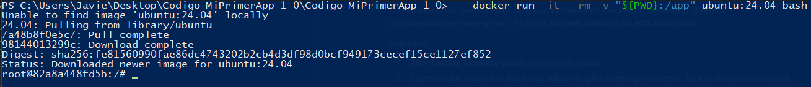
    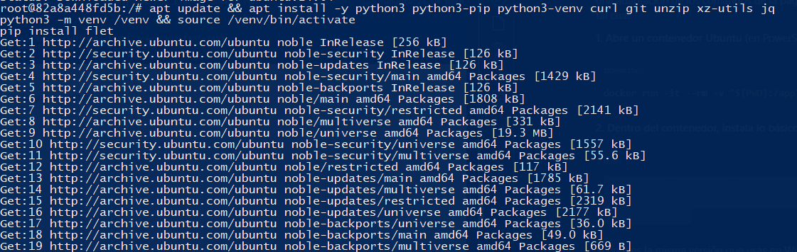
    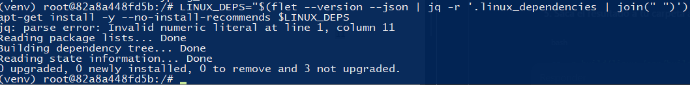
    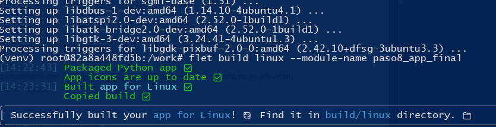
    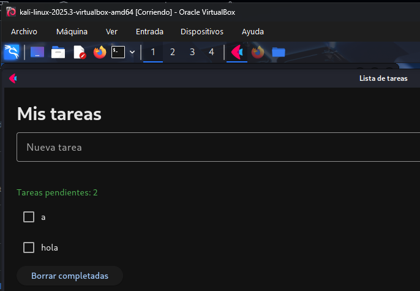{ width=600 }

!!! info "Entrega"
    Por su tamaño, el APK y los ejecutables no van en el repositorio: se suben como **Release** de GitHub (en esta práctica: `archivos-ejercicio-flet`, tag `v1.0`).
