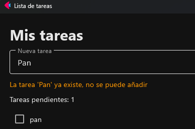

# Control de tareas repetidas

**Objetivo:** que no se pueda añadir una tarea que ya existe (sin distinguir mayúsculas) y avisar en naranja.

## 1. El mensaje (dentro de `main`, junto a los demás controles)

```python
mensaje = ft.Text("", color=ft.Colors.ORANGE)   # vacío al principio; naranja
```

| Código | Qué hace |
|---|---|
| `mensaje = ft.Text("", ...)` | Crea un texto **vacío**: no se ve nada hasta que le pongamos un `value`. |
| `color=ft.Colors.ORANGE` | El aviso sale en naranja. |

Y se añade a la página: `page.add(titulo, ..., mensaje, contador, tareas, ...)`.

## 2. La comprobación (dentro de `añadir_tarea`, **después** de comprobar que no está vacío y **antes** de crear la fila)

```python
for fila_existente in tareas.controls:
    if fila_existente.controls[0].label.lower() == texto.lower():
        mensaje.value = f"La tarea '{texto}' ya existe, no se puede añadir"
        page.update()
        return                       # sale sin añadir la tarea

mensaje.value = ""                   # si llegamos aquí, no era repetida: borramos el aviso
nueva_tarea.error = None
```

| Pieza | Para qué |
|---|---|
| `for fila_existente in tareas.controls` | Recorre las tareas que ya hay. |
| `controls[0].label` | Texto del `Checkbox` de esa fila. |
| `.lower()` en **ambos** lados | «Pan» y «pan» cuentan como la misma. |
| `return` | Sale de `añadir_tarea`: la tarea no se crea. |
| `mensaje.value = ""` | Limpia el aviso cuando ya se añade bien. |

!!! warning "Por qué ese lugar"
    Si la comprobación estuviera **después** de crear la fila, la tarea ya se habría añadido. Debe ir antes, y es un requisito *de cuando añadimos*, por eso va en `añadir_tarea`.

{ width=520 }
